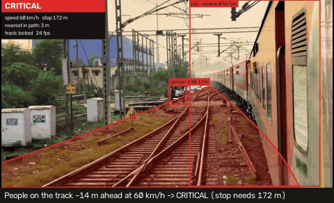
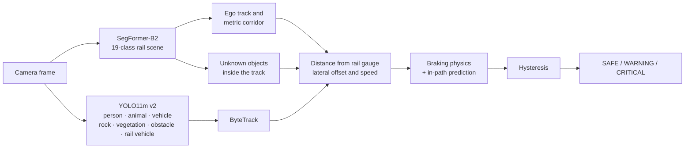

<div align="center">

# RailSight

**Vision-based railway hazard detection and collision-risk estimation from a forward-facing train camera**

[](https://github.com/Krishu-24/RailSight/actions/workflows/ci.yml)




<sub>Free Pexels clips · SegFormer-B2 + YOLO11m v2 on an RTX 5060 Laptop GPU · corridor colour = risk state, white ticks = distance along the track</sub>

</div>

A train cannot steer around an obstacle, so "there is a person in the image" is not enough. For every
hazard RailSight answers the two questions that matter:

1. **Is it in the train's path?** A segmentation model finds the ego track and builds a metric *danger
   corridor*, the space the train will sweep through.
2. **Can the train still stop?** The rail gauge is a known-size ruler that turns pixels into metres; the
   distance is compared with the braking distance at the current speed.

The answer is an interpretable **SAFE / WARNING / CRITICAL** state for every frame, in real time.

> Academic prototype (Manipal Academy of Higher Education, School of Computer Engineering) for
> perception and decision support. It is **not** a certified signalling or braking system.

**[Project report (PDF)](docs/RailSight_Report.pdf)** · [How it works](#how-it-works) · [Results](#results) ·
[Quick start](#quick-start) · [What we learned](#what-we-learned)

---

## Highlights

- **Real time:** about 28 FPS for the full pipeline on a laptop GPU (RTX 5060 Laptop, 8 GB).
- **Finds the ego track** on 99.9% of RailSem19 test frames; segmentation adds only 3.8 / 7.3 / 13.5%
  ranging error at 25 / 50 / 100 m.
- **Distances without a depth sensor or calibration:** rail-gauge ranging agrees with an independent
  human-height cue to within 0.5% on average (708 people at track level).
- **Detection that transfers to real cab-view footage:** adding ~16k boxes mined from RailSem19 masks
  raised cab-view mAP50 from under 0.08 to 0.48, where detectors tuned on web images had failed.
- **Unknown objects:** anything inside the track that is not track bed is flagged, even without a class.
- Everything is measured: every number in this README is regenerated from `reports/` by a script.

---

## Quick start

```bash
git clone https://github.com/Krishu-24/RailSight.git && cd RailSight
uv sync                     # Python 3.11 + PyTorch for CUDA 12.8 (RTX 50-series ready)
```

Get the trained weights (shared privately, see [Data and licences](#data-and-licences)) and unzip the
package in the repository root, then:

```bash
uv run railsight demo                                        # interactive app (video + image tabs)
uv run railsight video data/videos/clip.mp4 --speed 80       # annotated video, per-frame log, timeline
uv run python scripts/data/fetch_demo_videos.py              # the free demo clips used above
```

Per-camera options: `--hfov` (horizontal field of view, sets the distance scale) and `--ignore-below`
(fraction of the image showing the train itself, e.g. a dashboard). Everything else is in
[`configs/default.yaml`](configs/default.yaml) ([explained here](configs/README.md)).

---

## How it works



| Stage | Method | Learned? |
|---|---|---|
| Rail-scene segmentation | SegFormer-B2, compared with SegFormer-B0 and DeepLabV3-ResNet50 | fine-tuned on RailSem19 |
| Obstacle detection | YOLO11m v2 at 960 px, compared with YOLO11s / YOLO11m / RT-DETR-l v1 | fine-tuned (Roboflow + RailSem19 boxes) |
| Danger corridor | Ego-track tracing with robust width and centre fits, limited to rows where the track is visible | geometry |
| Distance | `Z = f · gauge / projected_gauge(row)` | geometry |
| Unknown objects | Non-track pixels inside the track, confirmed over 3 segmentation updates; off in low visibility | uses segmentation |
| Tracking | ByteTrack | off-the-shelf |
| Risk | Stopping distance `v·t + v²/2a`, in-path test over the arrival window, hysteresis | rules |

**Why rail-gauge ranging.** On flat track the projected gauge shrinks linearly towards the horizon. A
line fitted to the track width per image row gives the horizon and a pixels-per-metre scale at every
row, so anything touching the ground at row `y` is `Z = f · G / width(y)` away (G = 1.435 m standard,
1.676 m Indian broad gauge). The same scale widens the corridor to the real train width.

**Why the risk is rule-based.** No dataset labels "this frame was dangerous", and a safety decision
should be explainable, so learning handles perception and transparent physics makes the decision.

---

## Results

<!-- results:start -->
_Generated by `scripts/tools/make_readme_tables.py` from `reports/` and `runs/`._

| Segmentation (RailSem19 test, 850 frames) | mIoU (19 classes) | track IoU | FPS |
|---|---|---|---|
| SegFormer-B2 | 0.696 | 0.912 | 25 |
| DeepLabV3-ResNet50 | 0.677 | 0.914 | 30 |
| SegFormer-B0 | 0.645 | 0.881 | 59 |

| Detection, Roboflow test (268 images) | mAP50 (6 classes) | mAP50 (person / animal / vehicle) | mAP50-95 | recall small / medium / large |
|---|---|---|---|---|
| YOLO11s, COCO zero-shot | 0.290 | 0.579 | 0.141 | 0.41 / 0.64 / 0.68 |
| YOLO11s v1 | 0.666 | 0.800 | 0.358 | 0.90 / 0.78 / 0.82 |
| YOLO11m v1 | 0.694 | 0.816 | 0.372 | 0.93 / 0.78 / 0.81 |
| RT-DETR-l v1 | 0.712 | 0.837 | 0.390 | 0.96 / 0.90 / 0.93 |
| YOLO11m v2 | 0.716 | 0.825 | 0.391 | 0.88 / 0.78 / 0.83 |

| Detection, real cab-view frames (RailSem19 test, 850 images) | mAP50 (person / vehicle / rail vehicle) | AP50 person | AP50 vehicle | AP50 rail vehicle | mAP50-95 | recall small / medium / large |
|---|---|---|---|---|---|---|
| YOLO11s, COCO zero-shot | 0.189 | 0.22 | 0.18 | 0.17 | 0.089 | 0.06 / 0.39 / 0.53 |
| YOLO11s v1 | 0.064 | 0.10 | 0.09 | – | 0.024 | 0.01 / 0.15 / 0.21 |
| YOLO11m v1 | 0.055 | 0.08 | 0.09 | – | 0.021 | 0.00 / 0.11 / 0.19 |
| RT-DETR-l v1 | 0.076 | 0.12 | 0.11 | – | 0.028 | 0.01 / 0.26 / 0.29 |
| YOLO11m v2 | 0.431 | 0.52 | 0.49 | 0.28 | 0.236 | 0.19 / 0.58 / 0.73 |

Both tables above are at 640 px. v1 detectors were fine-tuned on the merged Roboflow sets only.
They score well on the Roboflow test split but **transfer poorly to real cab-view footage**: on
RailSem19 frames they fall below even the un-tuned COCO model, because the Roboflow images are
mostly close-up, staged scenes. **v2** adds ~16k training boxes derived from RailSem19's dense masks
(person, vehicle and a new `rail_vehicle` class, filtered against mask noise) and is about 7x
better than v1 on cab-view frames while also slightly better on the Roboflow split, so v2 is used
(fine-tuned at 960 px, below). RT-DETR-l v1 (trained on Kaggle, 2x T4) has the highest Roboflow
recall but is the slowest. Recall is measured at the operating confidence (0.25). Object size is
sqrt(box area) in original image pixels (Roboflow 640x640, RailSem19 1280x720), so a "small"
RailSem19 object is under 16 px at a 640 px detector input. RailSem19-derived labels come from
weakly supervised masks, and the Roboflow test has ~270 images, so small differences are within
noise.

| Input resolution (RailSem19 cab-view test) | mAP50 | mAP50-95 | AP50 person / vehicle / rail vehicle | recall small / medium / large |
|---|---|---|---|---|
| YOLO11m v2, trained and run at 640 px | 0.431 | 0.236 | 0.52 / 0.49 / 0.28 | 0.19 / 0.58 / 0.73 |
| YOLO11m v2, trained at 640, run at 960 px | 0.462 | 0.260 | 0.56 / 0.52 / 0.31 | 0.26 / 0.62 / 0.74 |
| **YOLO11m v2 fine-tuned at 960 px (default)** | 0.476 | 0.271 | 0.58 / 0.54 / 0.31 | 0.25 / 0.60 / 0.74 |

Most of the higher-resolution gain comes from running the detector at 960 px; fine-tuning at 960 px
adds ~1.5 points of mAP50 but no small-object recall. Distant objects (small recall ~0.25) remain the
main limitation of single-camera detection. The 960 px model is the default: on this GPU it costs
less than 1 FPS in the full pipeline.

| Corridor and unknown objects (RailSem19 test) | SegFormer-B2 | DeepLabV3-ResNet50 | SegFormer-B0 |
|---|---|---|---|
| Corridor found (frames with a real track) | 99.9% | 99.8% | 99.6% |
| Corridor IoU vs ground-truth corridor | 0.84 | 0.82 | 0.81 |
| Horizon error (median) | 4.1 px | 5.0 px | 5.6 px |
| Ranging deviation from segmentation, 25 / 50 / 100 m | 3.8% / 7.3% / 13.5% | 4.7% / 9.0% / 16.2% | 5.2% / 10.3% / 18.1% |
| Unknown objects (class-only, default): precision / recall / false alarms | 0.58 / 0.48 / 4.9% | 0.57 / 0.49 / 5.0% | 0.60 / 0.36 / 3.4% |
| Unknown objects + low-confidence pixels (<0.5) | 0.33 / 0.63 / 17.8% | 0.31 / 0.66 / 20.5% | 0.21 / 0.63 / 33.0% |

SegFormer-B2 and DeepLabV3 score the same track IoU, yet B2's corridor geometry is clearly better
(about 20% lower ranging deviation): pixel overlap does not capture how cleanly the track edges
follow the rails at long range, which is what ranging depends on. B2 is the default model.

| Ranging check: gauge distance ÷ human-height distance (RailSem19 people) | people | median ratio | robust spread |
|---|---|---|---|
| Feet at track level | 708 | 0.995 | ±31% |
| On platforms / elsewhere | 90 | 0.774 | ±59% |

The focal length cancels in this ratio, so the check needs no camera calibration. For people
standing at rail level, gauge ranging shows no scale bias; the spread is mostly the reference
itself (body height, posture, mask outlines). People on platforms stand above the rail plane, so
the flat-ground assumption underestimates their distance, as expected.

| Speed (RTX 5060 Laptop GPU, 960x540) | FPS |
|---|---|
| Full pipeline, segmentation every frame | 15.0 |
| Full pipeline, segmentation every 3rd frame (default) | 28.0 |
| Detectors alone (fp16) | rtdetr_l_rail @640px: 36, yolo11m_rail @640px: 70, yolo11m_rail_v2 @640px: 73, yolo11m_rail_v2_960 @960px: 77, yolo11s_rail @640px: 102 |

In back-to-back measurements, profiling-driven optimisation (fused SDPA attention, bf16, GPU-side
normalisation, fp16 detector) raised SegFormer-B2 from 14.8 to 21.0 FPS (+41%) and SegFormer-B0
from 22.3 to 47.0 FPS with unchanged predictions (>99.9% pixel agreement, identical detector test
mAP). Absolute FPS on a laptop depends on its power and thermal state: the same pipeline measured
between 17.7 and 28.0 FPS across sessions; the table shows the latest run on an idle machine.
<!-- results:end -->

---

## Data and licences

| Dataset | Used for | Licence / access |
|---|---|---|
| [RailSem19](https://wilddash.cc/railsem19) | Segmentation; mined detection boxes (v2) | Free registration per person; frames must not be redistributed |
| [railway (goal)](https://universe.roboflow.com/goal-lmqiu/railway-tfabb) | Detection | MIT |
| [Railway track obstacle detection](https://universe.roboflow.com/railway-research/railway-track-obstacle-detection-gca3w) | Detection | CC BY 4.0 |
| [Pexels](https://www.pexels.com/license/) cab-ride clips | Qualitative demos | Pexels licence (free to use) |

**Detection data v1** ([`prepare_detection.py`](scripts/data/prepare_detection.py)). An audit of the
Roboflow exports found that 74% of one set's boxes were weeds between sleepers seen by a top-down
inspection camera, and that the published splits **leaked** (augmented copies and consecutive video
frames in both train and test). Non-hazard classes were dropped, the rest mapped onto six hazards,
and near-duplicates grouped by perceptual hash before a stratified 80/10/10 re-split.

**Detection data v2** ([`prepare_detection_v2.py`](scripts/data/prepare_detection_v2.py)). Adds ~16k
training boxes (person, vehicle and a new `rail_vehicle` class) mined from RailSem19's dense masks
and filtered against mask noise. It keeps the segmentation split, so RailSem19 test frames stay unseen.

Because RailSem19 may not be redistributed, data, trained weights and RailSem19-based outputs are not
in this repository. The weights are shared privately with the team, guide and examiners
([`package_weights.py`](scripts/tools/package_weights.py)).

---

## Reproduce

Every step is a script; see **[scripts/README.md](scripts/README.md)** for the full list.

```bash
uv run python scripts/data/prepare_railsem19.py     # after downloading the datasets to data/raw/
uv run python scripts/data/prepare_detection_v2.py
bash scripts/train/train_all.sh                     # every training run, resumable
uv run python scripts/eval/eval_det.py              # and the other evaluations -> reports/
uv run python scripts/tools/make_readme_tables.py   # refresh the Results section
```

The larger detectors were trained on Kaggle's free GPUs: see [kaggle/README.md](kaggle/README.md).

---

## Project structure

```
RailSight/
├── railsight/        the library: segmentation, corridor geometry, risk, pipeline, CLI  → railsight/README.md
├── app/              Gradio demo                                                       → app/README.md
├── configs/          default.yaml: models, camera, track, braking, thresholds          → configs/README.md
├── scripts/          data / train / eval / tools                                       → scripts/README.md
├── kaggle/           notebook and guide for training detectors on Kaggle
├── reports/          every evaluation result as JSON + Markdown, and figures           → reports/README.md
├── docs/             project report (PDF), report notes, assets                        → docs/README.md
└── tests/            unit tests for geometry, risk, metrics and unknown-object logic
```

---

## What we learned

- **Test on the deployment viewpoint.** Detectors scoring 0.67–0.71 mAP50 on a web-image test set
  scored under 0.08 on real cab-view frames, below an un-tuned COCO model. Mining in-domain boxes from
  RailSem19's masks fixed it (0.48).
- **Audit public datasets before training.** One "railway obstacle" set was mostly weeds, and both
  published splits leaked between train and test.
- **The metric that matters may not be the standard one.** DeepLabV3 matched SegFormer-B2 on track IoU
  but produced ~20% worse distances.
- **Measure before optimising.** Profiling showed the segmentation network, not the logic, was the
  bottleneck; fused attention and bf16 gave +41% with identical predictions.
- **Real video exposes what test sets do not:** a camera seeing its own dashboard, darkness, and
  one-frame flicker each needed a specific fix, while some ideas (a motion-based vehicle mask,
  rail-pair gauge measurement) were tried, measured and dropped.

The full story, including what did not work, is in the **[project report](docs/RailSight_Report.pdf)**.

---

## Limitations

- **Distant objects:** recall for small (far) objects is about 0.25. At 100 km/h a train needs ~440 m
  to stop, where a person is a few pixels tall, so a single camera helps most at lower speeds, in yards,
  at stations and level crossings.
- **Ranging** assumes locally flat track and a known or assumed focal length; error grows with distance.
  Absolute accuracy was not checked against lidar (the OSDaR23 server was unavailable).
- **Switches and merged tracks** widen the corridor and shorten distances; level-crossing rails embedded
  in the road are partly segmented as road; darkness switches the unknown-object check off.
- **Small evaluation sets** (268 Roboflow test images) and weakly supervised RailSem19 labels: small
  differences between models are within noise.

---

## Acknowledgements

RailSem19 (AIT Austrian Institute of Technology), the Roboflow Universe dataset authors, and the Pexels
videographers for the data; SegFormer (NVIDIA, via Hugging Face Transformers), DeepLabV3 (torchvision),
YOLO11 / RT-DETR and ByteTrack (Ultralytics) for the models; Kaggle for free GPU time. Development was
assisted by Claude Code (Anthropic), an AI coding assistant.

**Team:** Arnav Keshav Sinha · Faizaan Naiman Naveed Nasir — **Guide:** Dr. Jayita Saha
