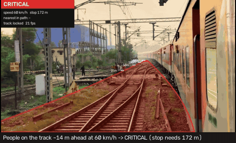

# RailSight

[](https://github.com/Krishu-24/RailSight/actions/workflows/ci.yml)

**Vision-based railway hazard detection and collision-risk estimation from a forward-facing train camera.**

RailSight does more than detect objects. For every hazard it answers the two questions that matter to a
train, which cannot steer around an obstacle:

1. **Is it in the train's path?** A segmentation model finds the ego track and builds a metric
   *danger corridor* (the space the train will sweep through).
2. **Can the train still stop?** The rail gauge acts as a known-size ruler, which turns pixels into
   metres; the distance is compared with the braking distance at the current speed.

The result is an interpretable **SAFE / WARNING / CRITICAL** state per frame.



_Free Pexels clips; SegFormer-B2 + YOLO11m v2 on an RTX 5060 Laptop GPU. The corridor colour is the current risk state, white ticks mark distance along the track._

> Academic prototype (MAHE, School of Computer Engineering) for perception and decision support.
> It is **not** a certified signalling or braking system.

---

## How it works

```
frame ─► SegFormer (RailSem19, 19 classes) ─► ego track ─► corridor fit ─► metric danger corridor
     │                                                          │  (gauge → px-per-metre per row)
     ├─► YOLO11 / RT-DETR (fine-tuned) ─► ByteTrack ──────────┐ │
     └─► foreign-pixel check inside the track (class-agnostic) ┤ │
                                                               ▼ ▼
            distance (pinhole + gauge) · lateral offset · lateral speed (from track history)
                                                               │
       speed + reaction time + braking ─► rule-based risk ─► hysteresis ─► SAFE / WARNING / CRITICAL
```

| Stage | Method | Trained by us? |
|---|---|---|
| Rail-scene segmentation | SegFormer-B2 (vs B0, DeepLabV3-ResNet50) | ✅ fine-tuned on RailSem19 |
| Obstacle detection | YOLO11m v2 (default) vs YOLO11s / YOLO11m / RT-DETR-l v1 | ✅ fine-tuned on Roboflow obstacle data (+ RailSem19 cab-view boxes for v2) |
| Danger corridor | Row-wise ego-track tracing + robust width/centre fits, limited to rows where the track is visible | geometry |
| Distance | `Z = f · gauge / projected_gauge(row)` | geometry |
| Unknown objects | Non-ground pixels inside the track, confirmed over 3 segmentation updates; skipped when track confidence is low (darkness, glare) | uses the segmentation model |
| Tracking | ByteTrack | off-the-shelf |
| Risk | Stopping distance `v·t_r + v²/2a`, in-path test over an arrival time window, hysteresis | rules |

### Why rail-gauge ranging
On flat track the projected rail gauge shrinks linearly towards the horizon. Fitting
`width(y) = a·y + b` to the segmented track gives the horizon row and a pixels-per-metre scale at
every image row. With gauge 1.435 m (standard) or 1.676 m (Indian broad gauge), the distance of
any object touching the ground at row `y` is `Z = f · G / width(y)`. The same scale widens the
corridor to the real train width (3.2 m + margin) regardless of how far away a row is.

### Why the risk is rule-based
No dataset labels "this frame was dangerous", and a safety decision should be explainable, so the
learned parts handle perception and the decision is made by transparent physics.

---

## Data

| Dataset | Used for | Notes |
|---|---|---|
| [RailSem19](https://wilddash.cc/railsem19) | Segmentation | 8,500 frames, 19 classes; fixed 80/10/10 split (seed 0) |
| [railway (goal)](https://universe.roboflow.com/goal-lmqiu/railway-tfabb) | Detection | MIT; 11 classes |
| [Railway track obstacle detection](https://universe.roboflow.com/railway-research/railway-track-obstacle-detection-gca3w) | Detection | CC BY 4.0; 6 classes |

**Detection data cleaning** (`scripts/prepare_detection.py`), based on an audit of the raw exports:
- Classes are mapped onto six hazards: `person, animal, vehicle, rock, vegetation, obstacle`.
- `Plant` (74% of boxes in one source: weeds between sleepers seen by a top-down inspection
  camera), standing `Tree`s and `flood` are not obstacles in the train's path, so they were dropped.
- The original splits **leaked**: Roboflow's augmented copies and consecutive video frames appeared
  in both train and test. Images are grouped by source filename and perceptual hash (dHash), and
  whole groups are re-split 80/10/10 with stratification on the rarest class. Val/test contain no
  augmented copies.

**Detection data v2** (`scripts/prepare_detection_v2.py`): the Roboflow set plus boxes derived from
RailSem19's dense masks (connected components of `human`, `car`/`truck` and `on-rails`), filtered
against mask noise (minimum size and fill ratio, no small border fragments, rail vehicles must stand
on track). This adds ~16k training boxes (person / vehicle / `rail_vehicle`) from real cab-view frames, keeps
the segmentation split (RailSem19 test frames stay unseen), and stays on the local machine because
RailSem19's licence forbids redistribution.

---

## Results

<!-- results:start -->
_Generated by `scripts/make_readme_tables.py` from `reports/` and `runs/`._

| Segmentation (RailSem19 test, 850 frames) | mIoU (19 classes) | track IoU | FPS |
|---|---|---|---|
| SegFormer-B2 | 0.696 | 0.912 | 25 |
| DeepLabV3-ResNet50 | 0.677 | 0.914 | 30 |
| SegFormer-B0 | 0.645 | 0.881 | 59 |

| Detection, Roboflow test (268 images) | mAP50 (6 classes) | mAP50 (person / animal / vehicle) | mAP50-95 | recall small / medium / large |
|---|---|---|---|---|
| YOLO11s, COCO zero-shot | 0.290 | 0.579 | 0.141 | 0.41 / 0.64 / 0.68 |
| YOLO11s v1 | 0.666 | 0.800 | 0.358 | 0.90 / 0.78 / 0.82 |
| YOLO11m v1 | 0.694 | 0.816 | 0.372 | 0.93 / 0.78 / 0.81 |
| RT-DETR-l v1 | 0.712 | 0.837 | 0.390 | 0.96 / 0.90 / 0.93 |
| YOLO11m v2 | 0.716 | 0.825 | 0.391 | 0.88 / 0.78 / 0.83 |

| Detection, real cab-view frames (RailSem19 test, 850 images) | mAP50 (person / vehicle / rail vehicle) | AP50 person | AP50 vehicle | AP50 rail vehicle | mAP50-95 | recall small / medium / large |
|---|---|---|---|---|---|---|
| YOLO11s, COCO zero-shot | 0.189 | 0.22 | 0.18 | 0.17 | 0.089 | 0.06 / 0.39 / 0.53 |
| YOLO11s v1 | 0.064 | 0.10 | 0.09 | – | 0.024 | 0.01 / 0.15 / 0.21 |
| YOLO11m v1 | 0.055 | 0.08 | 0.09 | – | 0.021 | 0.00 / 0.11 / 0.19 |
| RT-DETR-l v1 | 0.076 | 0.12 | 0.11 | – | 0.028 | 0.01 / 0.26 / 0.29 |
| YOLO11m v2 | 0.431 | 0.52 | 0.49 | 0.28 | 0.236 | 0.19 / 0.58 / 0.73 |

Both tables above are at 640 px. v1 detectors were fine-tuned on the merged Roboflow sets only.
They score well on the Roboflow test split but **transfer poorly to real cab-view footage**: on
RailSem19 frames they fall below even the un-tuned COCO model, because the Roboflow images are
mostly close-up, staged scenes. **v2** adds ~16k training boxes derived from RailSem19's dense masks
(person, vehicle and a new `rail_vehicle` class, filtered against mask noise) and is about 7x
better than v1 on cab-view frames while also slightly better on the Roboflow split, so v2 is used
(fine-tuned at 960 px, below). RT-DETR-l v1 (trained on Kaggle, 2x T4) has the highest Roboflow
recall but is the slowest. Recall is measured at the operating confidence (0.25). Object size is
sqrt(box area) in original image pixels (Roboflow 640x640, RailSem19 1280x720), so a "small"
RailSem19 object is under 16 px at a 640 px detector input. RailSem19-derived labels come from
weakly supervised masks, and the Roboflow test has ~270 images, so small differences are within
noise.

| Input resolution (RailSem19 cab-view test) | mAP50 | mAP50-95 | AP50 person / vehicle / rail vehicle | recall small / medium / large |
|---|---|---|---|---|
| YOLO11m v2, trained and run at 640 px | 0.431 | 0.236 | 0.52 / 0.49 / 0.28 | 0.19 / 0.58 / 0.73 |
| YOLO11m v2, trained at 640, run at 960 px | 0.462 | 0.260 | 0.56 / 0.52 / 0.31 | 0.26 / 0.62 / 0.74 |
| **YOLO11m v2 fine-tuned at 960 px (default)** | 0.476 | 0.271 | 0.58 / 0.54 / 0.31 | 0.25 / 0.60 / 0.74 |

Most of the higher-resolution gain comes from running the detector at 960 px; fine-tuning at 960 px
adds ~1.5 points of mAP50 but no small-object recall. Distant objects (small recall ~0.25) remain the
main limitation of single-camera detection. The 960 px model is the default: on this GPU it costs
less than 1 FPS in the full pipeline.

| Corridor and unknown objects (RailSem19 test) | SegFormer-B2 | DeepLabV3-ResNet50 | SegFormer-B0 |
|---|---|---|---|
| Corridor found (frames with a real track) | 99.9% | 99.8% | 99.6% |
| Corridor IoU vs ground-truth corridor | 0.84 | 0.82 | 0.81 |
| Horizon error (median) | 4.1 px | 5.0 px | 5.6 px |
| Ranging deviation from segmentation, 25 / 50 / 100 m | 3.8% / 7.3% / 13.5% | 4.7% / 9.0% / 16.2% | 5.2% / 10.3% / 18.1% |
| Unknown objects (class-only, default): precision / recall / false alarms | 0.58 / 0.48 / 4.9% | 0.57 / 0.49 / 5.0% | 0.60 / 0.36 / 3.4% |
| Unknown objects + low-confidence pixels (<0.5) | 0.33 / 0.63 / 17.8% | 0.31 / 0.66 / 20.5% | 0.21 / 0.63 / 33.0% |

SegFormer-B2 and DeepLabV3 score the same track IoU, yet B2's corridor geometry is clearly better
(about 20% lower ranging deviation): pixel overlap does not capture how cleanly the track edges
follow the rails at long range, which is what ranging depends on. B2 is the default model.

| Ranging check: gauge distance ÷ human-height distance (RailSem19 people) | people | median ratio | robust spread |
|---|---|---|---|
| Feet at track level | 708 | 0.995 | ±31% |
| On platforms / elsewhere | 90 | 0.774 | ±59% |

The focal length cancels in this ratio, so the check needs no camera calibration. For people
standing at rail level, gauge ranging shows no scale bias; the spread is mostly the reference
itself (body height, posture, mask outlines). People on platforms stand above the rail plane, so
the flat-ground assumption underestimates their distance, as expected.

| Speed (RTX 5060 Laptop GPU, 960x540) | FPS |
|---|---|
| Full pipeline, segmentation every frame | 15.0 |
| Full pipeline, segmentation every 3rd frame (default) | 28.0 |
| Detectors alone (fp16) | rtdetr_l_rail @640px: 36, yolo11m_rail @640px: 70, yolo11m_rail_v2 @640px: 73, yolo11m_rail_v2_960 @960px: 77, yolo11s_rail @640px: 102 |

In back-to-back measurements, profiling-driven optimisation (fused SDPA attention, bf16, GPU-side
normalisation, fp16 detector) raised SegFormer-B2 from 14.8 to 21.0 FPS (+41%) and SegFormer-B0
from 22.3 to 47.0 FPS with unchanged predictions (>99.9% pixel agreement, identical detector test
mAP). Absolute FPS on a laptop depends on its power and thermal state: the same pipeline measured
between 17.7 and 28.0 FPS across sessions; the table shows the latest run on an idle machine.
<!-- results:end -->

---

## Setup

Requires an NVIDIA GPU. The lockfile pins PyTorch built for CUDA 12.8, which RTX 50-series cards need.

```bash
uv sync
uv run pytest
```

## Reproduce

```bash
# data (place raw downloads under data/raw/, see the table above)
uv run python scripts/prepare_detection.py
uv run python scripts/prepare_railsem19.py
uv run python scripts/prepare_detection_v2.py      # + boxes from RailSem19 masks (local only, licence)
uv run python scripts/fetch_demo_videos.py         # free Pexels demo clips -> data/videos/

# every training run, one GPU job at a time (pass a step number to resume)
bash scripts/train_all.sh

# evaluation tables -> reports/
uv run python scripts/eval_det.py
uv run python scripts/train_seg.py --arch segformer-b2 --eval-only --split test
uv run python scripts/eval_scene.py --weights runs/seg/segformer-b2/best --split test   # -> reports/scene_segformer-b2/
uv run python scripts/eval_ranging_consistency.py   # gauge vs human-height distance, no calibration needed
uv run python scripts/benchmark.py                  # FPS of every model and the full pipeline
uv run python scripts/make_readme_tables.py         # refresh the Results section above
uv run python scripts/make_demo_gif.py              # docs/demo.gif from outputs/final
```

The two larger detectors were trained on Kaggle's free GPUs: see [`kaggle/README.md`](kaggle/README.md).

## Run

```bash
uv run python scripts/run_video.py data/videos/clip.mp4 --speed 80   # annotated video + log + timeline
uv run python app/gradio_app.py                                      # interactive demo
```

Per-camera options: `--hfov` (horizontal field of view, which sets the distance scale) and
`--ignore-below` (fraction of the image height that shows the train itself, e.g. a dashboard).
Everything else (gauge, braking, margins, thresholds) is in [`configs/default.yaml`](configs/default.yaml).

## Repository layout

```
railsight/   corridor.py  risk.py  seg.py  anomaly.py  pipeline.py  video.py  metrics.py  datasets.py
scripts/     prepare_*.py  train_*.py  eval_*.py  benchmark.py  run_video.py  make_readme_tables.py
kaggle/      notebook + guide for training detectors on Kaggle
docs/        report notes (sourced statistics, related systems)
app/         gradio_app.py
configs/     default.yaml
tests/       geometry, risk logic, metrics and unknown-object persistence unit tests
```

## Limitations

- Gauge ranging assumes locally flat track and a known (or assumed) focal length; error grows with
  distance as the projected gauge shrinks to a few pixels.
- At 100 km/h the stopping distance is about 440 m, where a person is only a few pixels tall for a
  standard camera. Monocular perception mainly helps at lower speeds and in yards and at crossings.
- Switches: the ego path follows the branch closest to the previous row, which is not necessarily
  the route the train will take. Where tracks merge, the corridor gets too wide and distances too
  short (an experimental rail-pair gauge measurement, `track.rail_pairs`, helps there but hurts
  elsewhere, so it is off).
- Absolute distance accuracy was not measured against lidar (OSDaR23's server was unavailable);
  the calibration-free human-height check shows no scale bias at track level but a wide spread.
- Cameras inside the cab see their own dashboard, which segmentation can mistake for track: set
  `--ignore-below` once per mounting. At level crossings rails embedded in the road are partly
  segmented as road. In darkness the unknown-object check switches off (shown as LOW VISIBILITY).
- Evaluation sets are small (268 Roboflow test images), so detector differences of a few points
  are within noise; RailSem19-derived boxes come from weakly supervised masks.

## Team

Arnav Keshav Sinha · Faizaan Naiman Naveed Nasir. Guide: Dr. Jayita Saha.
