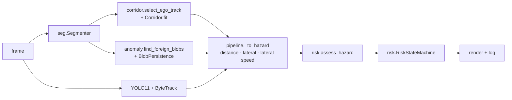

# `railsight` — the library

Everything the pipeline does at run time lives here; the scripts in [`../scripts`](../scripts) only
prepare data, train and evaluate.

## Data flow per frame



`pipeline.RailSightPipeline.process()` runs this for one frame; `video.process_video()` runs it over a
clip and writes the annotated video, a per-frame CSV log and a risk timeline.

## Modules

| Module | Purpose | Heavy dependencies |
|---|---|---|
| [`classes.py`](classes.py) | RailSem19 class ids and the groups used by the pipeline (track, rails, ground) | none |
| [`corridor.py`](corridor.py) | Ego-track selection, row tracing, robust width / centre fits; the `Corridor` gives distance, lateral offset, polygon and mask | numpy, OpenCV |
| [`risk.py`](risk.py) | Stopping distance, rule-based hazard assessment over the arrival window, hysteresis state machine | none |
| [`anomaly.py`](anomaly.py) | Class-agnostic foreign-object blobs inside the track; temporal confirmation (`BlobPersistence`) | numpy, OpenCV |
| [`metrics.py`](metrics.py) | Framework-independent detection metrics (AP, recall by object size) | numpy |
| [`seg.py`](seg.py) | Segmentation models (SegFormer B0/B1/B2, DeepLabV3) and the fast inference wrapper `Segmenter` | PyTorch, Transformers |
| [`datasets.py`](datasets.py) | RailSem19 training dataset with augmentation | PyTorch |
| [`pipeline.py`](pipeline.py) | Per-frame orchestration, hazard conversion, rendering of the overlay | PyTorch, Ultralytics |
| [`video.py`](video.py) | Whole-video processing, logs and timeline plot | imageio, matplotlib |
| [`config.py`](config.py) | Loads [`configs/default.yaml`](../configs/default.yaml) | PyYAML |
| [`cli.py`](cli.py) | `railsight video …` and `railsight demo` | — |

The geometry, risk, anomaly and metrics modules import no deep-learning libraries, so their unit tests
run in seconds and in CI without a GPU.

## Using it from Python

```python
import cv2
from railsight.config import load_config
from railsight.pipeline import RailSightPipeline

pipe = RailSightPipeline(load_config())
pipe.speed_kmh = 80
result = pipe.process(cv2.imread("frame.jpg"), t_s=0.0)
print(result.state.name, [(a.hazard.label, round(a.hazard.distance_m)) for a in result.assessments])
cv2.imwrite("annotated.jpg", result.image)
```
